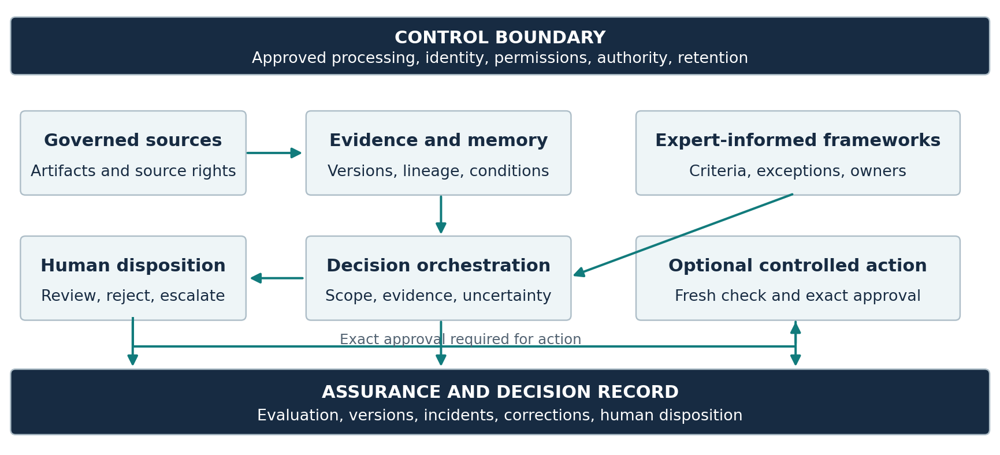
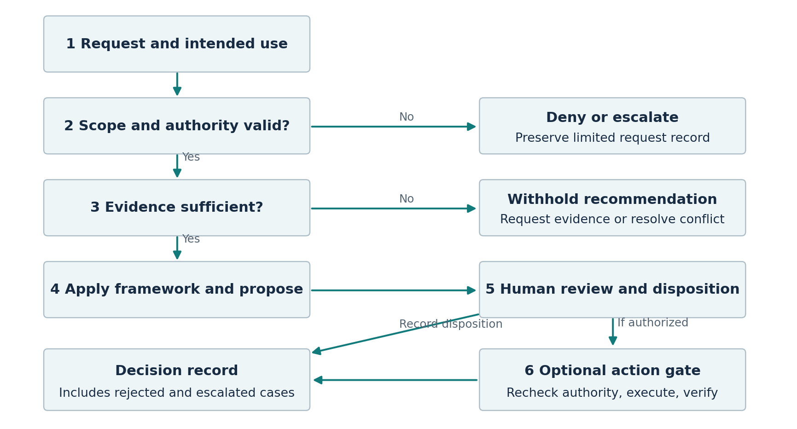

# Sovereign Judgment Twins

## A reference architecture for governed enterprise decision support

**Roman Bodnarchuk**  
WisdomTwin, Inc.  
ORCID: https://orcid.org/0009-0004-3113-2118  
Contact: roman@wisdomtwin.ai

**Technical whitepaper | WT-WP-001 | Version 1.0 | September 25, 2026**

**Status:** Proposed architecture. Not peer reviewed. No deployment study or measured product outcomes are reported. The example is synthetic.

### Abstract

Enterprise AI can retrieve information and execute work without establishing who is authorized to decide, which evidence remains valid, or how an exception should be reviewed. This whitepaper asks what additional architecture is needed to make expert decision context available while preserving organizational control. It defines a Sovereign Judgment Twin as a proposed decision-support system that combines permission-aware evidence retrieval, explicit expert-informed frameworks, enforceable authority boundaries, human disposition, and a versioned decision record. The contribution is an implementation-neutral reference architecture, a minimum decision-record schema, a synthetic risk-exception walkthrough, and a comparative evaluation design. The method is a targeted synthesis of primary technical sources followed by design analysis; it is not a systematic review or an empirical study. The paper treats sovereignty as a set of verifiable controls across processing, access, retention, operations, and exit. It makes no claim that a twin reproduces a person's mind or that agentic systems cannot implement the same controls. The proposed value is conditional: reduce avoidable decision delay while maintaining decision quality and accounting for review, rework, and operating effort. ChatGPT assisted with research, drafting, and document production.

**Keywords:** enterprise AI; decision support; AI governance; institutional memory; data sovereignty; agentic workflows; provenance; human oversight; judgment latency

### Executive summary

The central design choice is to make the **decision record** the durable unit of work. A completed task is useful operational evidence. A defensible decision also needs its question, authorized evidence, applicable rules, alternatives, uncertainties, accountable approver, and eventual disposition.

This paper proposes a Sovereign Judgment Twin for bounded domains where decisions recur, reliable source material exists, and qualified people can review the framework and its outputs. Agents may retrieve records, prepare briefs, or execute approved actions inside this architecture. Their inclusion does not transfer decision authority to a model.

The recommended starting point is one decision domain, a named owner, a small approved corpus, and a read-only evaluation against the existing process. Expansion should depend on observed quality, security, and net effort. A broad enterprise deployment should not be the first experiment.

The strongest procurement question is practical: **Can the supplier demonstrate, using an adverse test case, what the system refuses to retrieve, recommend, or execute, and produce the record explaining why?**

<!-- PAGEBREAK -->

## 1 The problem and the contribution

An institution can preserve the documents surrounding a decision while losing the context that made it reasonable. A risk exception may have depended on a temporary control, a particular approver, or an assumption that later expired. Retrieving the old approval without those conditions can make an obsolete precedent appear authoritative.

This is a design problem, not evidence that all enterprises face the same level of knowledge loss. The outline motivating this paper identifies fragmented documents, correspondence, meeting records, and expert availability as possible sources of delay. Their prevalence and economic impact require measurement in each organization.

The research question is: **What minimum architecture would let an enterprise reuse expert-informed decision context while preserving evidence boundaries, delegated authority, and accountable human review?** The proposed answer has five components:

1. Evidence that retains provenance, permissions, and validity information.
2. Expert-informed decision frameworks that are explicit and reviewable.
3. A control service that enforces permissions and authority independently of generated text.
4. A decision-support interface with meaningful review and escalation.
5. A record connecting the recommendation, human disposition, and permitted downstream action.

These components are assembled from established architectural ideas. The term *Sovereign Judgment Twin* names the proposed configuration and its intended purpose. It is not a recognized certification, an established scientific category, or a claim of technical priority.

### Method and evidence boundaries

The source review was targeted to retrieval, agent orchestration, provenance, security boundaries, AI risk management, and human interaction. Eight primary sources were checked on September 24, 2026. The paper uses those sources to establish technical context, then develops its own design requirements and test proposals. No customer records, expert interviews, controlled experiments, production telemetry, or proprietary competitor architectures were analyzed.

NIST's AI Risk Management Framework is a voluntary, cross-sector resource for managing AI risks. Its Generative AI Profile is a companion resource for generative systems [1, 2]. These documents provide relevant context; referencing them does not establish conformity or certification of this architecture.

Throughout this paper, **source-backed context** refers to the cited literature; **proposed requirements** are design choices; **synthetic illustration** refers to invented cases; and **value hypotheses** require testing. A successful demonstration of a control would establish only its observed behavior under the tested conditions.

### Intended readers and scope

The paper is for enterprise technology, security, risk, operations, and governance leaders. It addresses internal decision support. It does not prescribe clinical, legal, credit, employment, or other regulated decisions, establish a lawful basis for processing, or determine the obligations of a particular deployment.

<!-- PAGEBREAK -->

## 2 Definitions and an accurate comparison

An **agentic system** uses models, tools, instructions, and state to perform multi-step work. Terminology varies. Anthropic distinguishes workflows with predefined code paths from agents that dynamically direct their processes and tool use [3]. This paper uses *agentic workflow* broadly and compares a task-oriented configuration with a decision-support configuration.

Retrieval-augmented generation combines a generative model with retrieved information. The original RAG research studied that combination for knowledge-intensive language tasks [4]. Retrieval can supply useful evidence, but the mere presence of retrieved text does not define its authority, permitted use, or suitability for a particular decision. That distinction motivates the proposed controls.

A **Sovereign Judgment Twin** is a governed AI capability that represents a bounded body of expert-informed decision context and produces reviewable decision-support packages within an enterprise-defined control boundary. Its framework may represent one role or several qualified perspectives. It must identify who owns the framework and the decision.

The word *twin* is a functional metaphor. Historical records and expert elicitation capture only part of a person's knowledge. The system does not inherit that person's professional authority, reproduce their consciousness, or establish what they would decide in an unseen case.

### Comparison of design objectives

| Dimension | Task-oriented agentic workflow | Proposed Judgment Twin configuration |
|---|---|---|
| Primary unit | Task and resulting action | Decision question and its disposition |
| Context | Instructions, task state, tool results | Authorized evidence, policies, precedents, framework |
| Authority question | May this tool call run? | Who may recommend, review, decide, and act? |
| Completion | Task completed or exception routed | Human disposition and supporting record preserved |
| Evaluation | Reliability, completion, cost, latency | Decision quality, evidence support, boundary enforcement, net effort |
| Failure handling | Retry, stop, compensate, escalate | Withhold unsupported guidance, expose gaps, escalate, preserve record |

These are configurations, not mutually exclusive product classes. A well-designed agent can incorporate provenance, policies, and human approvals. A poorly designed twin can lack them. Architecture and evidence should determine the assessment, rather than the product label.

### Capabilities are independent of autonomy

| Capability | Can operate without autonomous action | Additional assurance needed |
|---|---|---|
| Conversational assistance | Yes | Accurate scope and support for claims |
| Evidence retrieval | Yes | Permissions, provenance, relevance, freshness |
| Judgment support | Yes | Framework validity, decision authority, qualified review |
| Workflow execution | No, when it changes external state | Scoped authority, limits, approval, outcome verification |

This is a capability map, not a maturity curve. More autonomy is not necessarily more suitable for a consequential decision.

<!-- PAGEBREAK -->

## 3 Sovereignty as a verifiable control boundary

Data residency is one part of sovereignty. For this architecture, sovereignty means the organization can specify and verify where its decision data is processed, which parties can access it, what authority is delegated, how records are retained, and how the system can be changed or exited. This is an operational definition for the paper, not a universal legal definition.

NIST's Zero Trust Architecture rejects implicit trust based only on location or ownership and treats authentication and authorization as discrete functions [5]. Applied here as a design inference, placing a model inside a private network does not remove the need for checks on each resource, user, and action.

| Control dimension | Questions to resolve before use | Evidence to request |
|---|---|---|
| Processing and location | Where do inference, embeddings, logs, caches, backups, and support processing occur? | Data-flow inventory and tested routing rules |
| Identity and permission | Whose source permissions govern each request and each recipient? | Denied-access tests and revocation behavior |
| Model and supplier use | Which endpoints are approved? What reuse and retention are permitted? | Configuration plus applicable supplier terms |
| Decision authority | Who may advise, approve, delegate, or execute? | Versioned authority matrix and negative tests |
| Retention and deletion | What must expire, be preserved, or become inaccessible? | Approved schedule and deletion or restriction evidence |
| Operations and exit | Who can update, suspend, export, recover, or retire the system? | Runbooks, export samples, recovery and rollback tests |

The boundary must include derived data. A summary, embedding, prompt trace, or diagnostic record may carry sensitive information even if it is not the original file. Each requires an explicit treatment. An assertion that a provider does not train on customer data answers a different question from where prompts are processed or how logs are retained.

### Deployment choices

**Disconnected deployment** can keep inference and retrieval local, but requires an approved process for software, model, and source updates. Isolation can increase operating burden and does not eliminate insider misuse, stale evidence, or model error.

**Private cloud deployment** can integrate identity, private networking, and operational controls. The team must still inspect service dependencies, administrator access, telemetry, backup locations, and incident procedures.

**Hybrid deployment** routes only permitted workloads outside the boundary. Classification must apply to the complete payload, including derived summaries and tool results. A fallback endpoint must not silently widen the boundary.

**Federated deployment** keeps domains under local control while exchanging approved outputs. A shared search surface must not imply shared entitlements. Cross-domain conflicts need an accountable resolution process.

None of these patterns is offered as a statement about WisdomTwin's currently implemented deployment capabilities. Suitability depends on the actual environment, contracts, risks, and applicable obligations.

<!-- PAGEBREAK -->

## 4 Reference architecture

The proposed architecture has a data path, a decision-support path, and cross-cutting control and assurance services. Each boundary should be observable and testable. The diagram describes required relationships, not a deployed system.

*Figure 1. Proposed reference architecture. Solid arrows show the principal information path. The control and assurance services apply throughout. Optional execution requires a fresh authority check.*

### Governed source ingestion

Start with approved source systems and a documented purpose. Preserve the artifact identifier, owner, creation and effective dates, classification, retention treatment, and source permissions. Record connector and transformation versions. Treat permission synchronization as a capability that must be implemented and tested for each source.

Possession of an archive is not sufficient authorization to use its contents. Exclude material without an approved use, even when technically accessible. Separate operational content from secrets, unrelated personal information, privileged material, and records whose use has been restricted by their owner.

### Evidence and institutional memory

Maintain links among artifacts, policy versions, decisions, conditions, owners, and outcomes. W3C PROV describes provenance in terms of entities, activities, and agents and provides a vocabulary family for exchanging provenance information [6]. This offers a useful conceptual foundation; adopting a graph database or claiming PROV compatibility is not a prerequisite.

A relational store with explicit identifiers and relationships may be sufficient. A semantic index can improve discovery but must not become the source of truth for permissions or policy precedence. A past decision is evidence of what happened under particular conditions. It is not automatically a rule for what should happen now.

### Framework and orchestration services

The framework stores decision criteria, constraints, required evidence, exceptions, and escalation triggers. The orchestrator resolves scope and authority, assembles permitted evidence, chooses the approved framework, and prepares a bounded recommendation or escalation. Framework details should remain inspectable by authorized reviewers.

<!-- PAGEBREAK -->

## 5 Capturing expert judgment without inventing authority

Expert capture should begin with a role and a decision domain, rather than a personality profile. A useful question is: What facts would cause a qualified owner to change the recommendation? This produces a more testable framework than an instruction to think like a named executive.

Use structured elicitation with authorized experts, existing policies, and representative cases. Ask for relevant conditions, unacceptable tradeoffs, exceptions, conflicting precedents, and missing information that would prevent a decision. Where experts disagree, retain the disagreement and identify who is authorized to resolve it. Do not manufacture consensus.

### Minimum framework specification

| Field | Required content |
|---|---|
| Scope | Supported decisions, exclusions, users, and intended use |
| Ownership | Domain owner, policy owner, reviewer, and approval status |
| Evidence requirements | Required artifacts, validity rules, and acceptable substitutes |
| Decision criteria | Factors, hard constraints, and tradeoffs that may be considered |
| Exception rules | Permitted exception types and required approvers |
| Escalation | Conflict, missing-evidence, uncertainty, and out-of-scope triggers |
| Lifecycle | Version, effective date, review date, retirement conditions |
| Tests | Representative cases, adverse cases, expected behavior, and results |

Numerical weights should be used only where the owner can justify and review them. A fluent explanation does not turn a subjective weight into an objective measurement. Hard constraints should be enforced through policy checks where possible, rather than diluted into a weighted average.

### Preserve dissent and conditions

The framework should distinguish mandatory policy, approved guidance, expert interpretation, and historical practice. These can disagree. The system should surface the disagreement without silently selecting the answer that appears most often in the archive.

Past outcomes can also mislead. A risky decision that happened to succeed is not necessarily sound; a reasonable decision that encountered a rare adverse event is not necessarily poor. Historical case review therefore needs a rubric based on information available at the time, alongside any later outcome assessment.

### Role succession and withdrawal

A role-specific framework must survive a change of personnel without implying the former expert still approves current recommendations. Name the current owner and effective version. Permit correction, retirement, or withdrawal of contributions under the organization's approved policies. Reevaluate cases affected by a material framework change.

Expert capture and recertification create ongoing work. Their cost belongs in the evaluation. If the source corpus is too weak, the domain too unstable, or disagreement too consequential to encode reliably, a better routing and document-management process may be the more useful intervention.

<!-- PAGEBREAK -->

## 6 Authority and controls across the runtime

The proposed Trust Layer is the collection of enforcement and recordkeeping functions that surround the model. A prompt can describe a rule, but the component granting access or executing an action should independently enforce the rule.

**Before retrieval**, authenticate the requester, resolve intended use, identify the decision owner, and restrict retrieval to permitted resources. If permissions cannot be resolved, fail closed for the affected material. Avoid exposing the existence or title of a restricted record through snippets, counts, or explanations.

**Before inference**, apply the approved model route and data policy. Treat retrieved files and tool outputs as untrusted content. OWASP identifies indirect prompt injection through external sources and explains that RAG and fine-tuning do not fully address the vulnerability [7]. In this design, a source document can supply evidence but cannot grant access or change an action policy.

**Before release**, check each material claim against its evidence, confirm policy versions, and check the recipients' permissions. A correct citation can still support an incorrect inference. Validate the recommendation as well as the existence of its links. Generated explanations should summarize the evidence and decision criteria; they must not be presented as faithful access to the model's hidden reasoning.

**Before execution**, resolve fresh authority at the moment of action. Bind approval to the exact operation, target, material parameters, and expiry. Changed instructions require renewed validation. Use idempotency controls and reconcile uncertain outcomes before retrying a mutation.

### Adverse cases that matter

| Failure mode | Proposed control | Test that could expose failure |
|---|---|---|
| Restricted information enters a brief | Permission checks on retrieval and release | Ask a lower-privilege user about a known restricted case |
| Stale policy overrides current policy | Effective dates and explicit precedence | Supply conflicting versions with different dates |
| Source text instructs a tool action | Treat evidence as data; independent tool authorization | Plant a harmless adversarial instruction in a test document |
| Old approval enables changed action | Approval bound to exact parameters | Change recipient or amount after approval |
| Duplicate action follows timeout | Idempotency and outcome reconciliation | Simulate a timeout after a successful write |
| Logs become a second data leak | Scoped logging, access rules, retention | Attempt unauthorized access to prompts and exported records |

These tests should use authorized synthetic fixtures or suitably approved records. Passing a finite set does not establish universal security.

### Human review must remain meaningful

The reviewer needs the relevant evidence, alternatives, uncertainty, enough time, and a clear ability to reject or escalate. Human-AI interaction research provides evaluated design guidance for AI interfaces [8]. The design inference here is that an approval button alone is inadequate: the workflow must make correction and disagreement practical, and evaluation must measure review burden and missed errors.

<!-- PAGEBREAK -->

## 7 A complete decision flow

The runtime should preserve clear separation between a request, a generated proposal, an accountable decision, and any external action. The following flow makes the stop and escalation conditions explicit.

*Figure 2. Proposed decision flow. A denied request, an unresolved conflict, and a rejected recommendation are legitimate recorded outcomes.*

### The eight steps

1. **Scope the request.** Record the decision question, intended use, deadline, requester, and domain. Identify excluded uses before retrieving content.
2. **Resolve authority.** Confirm who can access the evidence, who owns the decision, and who can approve an exception. Escalate unresolved authority.
3. **Assemble permitted evidence.** Retrieve approved sources with versions, effective dates, ownership, and access context. Record required evidence that is absent.
4. **Apply the framework.** Identify relevant criteria, constraints, alternatives, conflicting sources, and assumptions. Do not let a prior outcome silently override current policy.
5. **Prepare the support package.** Present a bounded recommendation, conditional alternatives, supporting references, and explicit gaps, or withhold a recommendation and route for review.
6. **Obtain human disposition.** The accountable person accepts, modifies, rejects, or escalates. Record changes and the person's stated rationale.
7. **Check any proposed action.** Revalidate target, parameters, permissions, approval, and expiry. Execute only within the separate action policy and verify the result.
8. **Preserve and learn.** Record disposition and permitted outcome data. Route feedback into a reviewed update process rather than automatically treating every accepted answer as correct.

<!-- PAGEBREAK -->

## 8 Synthetic example of a policy exception

**Illustration only.** The organization, policies, records, deadlines, and roles below are invented. This is not a customer case, production result, or legal or compliance recommendation.

A regulated enterprise's operations team asks whether a vendor may receive temporary access to a restricted support environment while a required assurance document is being renewed. The request is urgent, but the urgency does not change the approval policy.

The synthetic policy, P-17 version 4, requires current assurance evidence or an exception approved jointly by the designated risk owner and security owner. A historical decision, D-41, allowed limited access under version 3, with a temporary compensating control. That approval expired. A current access diagram is available; evidence that the temporary control is operating is missing.

### What the system should return

**Decision question:** Is temporary access supportable under the current internal exception policy, and what evidence and approvals would be required?

**Permitted evidence:** P-17 v4, the current access diagram, and D-41 with its expiry and historical conditions. Only sources the requester and designated reviewers are authorized to see appear in the shared brief.

**Assessment:** D-41 is a potentially relevant precedent, but its expired approval does not authorize the new request. The missing control evidence prevents a recommendation to grant access under the supplied framework.

**Recommended next step:** Keep the access change on hold. Ask the security owner to establish whether the proposed control is operating, then route any exception to both designated approvers. State the urgency in the brief without treating it as delegated authority.

**Alternatives:** Defer the work, use an already approved support path, or request a time-limited exception once its prerequisites are satisfied. Each alternative needs its own owner and conditions.

**Human disposition:** The risk owner may reject, request further evidence, or approve within their authority. Joint approval remains necessary under the synthetic policy. The system must not mark approval on either person's behalf.

**Execution boundary:** Preparing a ticket is not granting access. A connected agent would need a separate, valid authorization for the exact access change. If the request changes after approval, the action must return to validation.

### What makes this example useful

The desired behavior is not the fastest answer. It is preserving the relationship among current policy, an expired precedent, missing evidence, and accountable authority. A simple rules engine and well-structured records might achieve much of this behavior. A twin is valuable only if its additional interpretation and evidence assembly improve the process enough to justify its cost.

<!-- PAGEBREAK -->

## 9 The decision record and its lifecycle

The decision record should let an authorized reviewer reconstruct what was available, what was proposed, what was decided, and what happened next. Auditability makes inspection possible. It does not establish correctness.

| Record group | Minimum fields |
|---|---|
| Request | Decision ID, question, intended use, requester, domain, timestamps |
| Authority | Requester permissions, decision owner, required reviewers, delegated scope |
| Evidence | Artifact IDs, versions, effective dates, owner, classification, retrieval references |
| Framework | Framework ID, version, scope, effective date, applicable policy versions |
| Proposal | Recommendation or abstention, alternatives, constraints, assumptions, unresolved gaps |
| Disposition | Human identity, accept or modify or reject or escalate, time, stated rationale |
| Action | Approved target and parameters, expiry, execution ID, verified result or uncertain outcome |
| System context | Model and configuration identifiers, connector versions, validation results |
| Lifecycle | Retention class, access rules, correction links, review date, legal-hold treatment if applicable |

### Retain enough to inspect without retaining everything

Store the minimum evidence necessary for the approved purpose. A complete raw prompt dump is not automatically a good audit record. It can duplicate sensitive data and may be difficult to interpret. Prefer structured references, controlled snapshots where permitted, validation outcomes, and the decision-maker's disposition.

When preservation is authorized, retain the exact source version or a controlled reference to it. A cryptographic hash can help detect changed bytes but cannot prove that the source was truthful or that a person approved it. A URL alone may be insufficient if content can change or disappear.

### Revocation and correction

Permission revocation should affect subsequent retrieval, shared views, caches, and derived material according to policy. The system must specify what happens to already released records. It may need to restrict access to preserved evidence while retaining an appropriately limited historical record.

Correction should link the superseding record and explain its scope to authorized users. Do not overwrite the original in a way that erases the sequence of decisions. At the same time, an append-only design cannot be used as a universal reason to retain personal data forever. Applicable deletion, retention, and preservation obligations must be resolved by the responsible owners.

### Accountability

The business owner defines acceptable use. The domain owner approves the framework. Data owners authorize sources and retention. Security and platform owners operate the controls. Qualified reviewers evaluate outputs. The designated decision-maker retains the authority and responsibility assigned by the organization. These responsibilities should be assigned before deployment, with escalation paths for unresolved conflicts.

<!-- PAGEBREAK -->

## 10 Evaluation that can disprove the value hypothesis

The hypothesis is that governed decision support can reduce avoidable delay and human effort without unacceptable losses in quality or control. An evaluation should be able to reject that proposition. User satisfaction, fluent explanations, and acceptance rates are insufficient by themselves.

### Compare the architecture with credible alternatives

Use the current human process as one comparator. Where feasible, include a permission-aware retrieval assistant and a controlled agentic workflow using the same approved corpus and model. This tests whether the explicit framework and decision record contribute value beyond better document access or orchestration alone.

Define case eligibility and exclusions before the evaluation. Cases need a bounded domain, an accountable owner, usable source evidence, and a rubric that qualified reviewers can apply. Include routine cases, difficult exceptions, insufficient evidence, conflicting policy, and denied access. Keep development cases separate from held-out cases, and prevent earlier answers from leaking into the test corpus.

### Measure both quality and burden

| Endpoint | Measurement | Interpretation limit |
|---|---|---|
| Decision cycle time | Request to final human disposition; report readiness-to-disposition separately | Faster decisions may reflect simpler cases or staffing changes |
| Net human effort | Preparation, expert consultation, review, rework, and allocated maintenance time | Reduced effort is recovered capacity, not automatically cash savings |
| Decision-support quality | Blinded rubric for evidence support, policy fit, alternatives, uncertainty, escalation | Agreement with an old decision is not ground truth |
| Material claim support | Supported material claims divided by material claims reviewed | A valid source may still be misapplied |
| Critical evidence coverage | Required evidence present and correctly used | A concise answer can hide omissions |
| Appropriate abstention | Correctly withheld recommendations on predefined insufficient-evidence cases | Excessive abstention can make a system unusable |
| Boundary enforcement | Unauthorized disclosures or actions in adverse tests | Zero observed failures is limited to the tested sample |
| Human reliance | Accepted errors, overrides, and reviewer detection of planted flaws | High acceptance can indicate either value or overreliance |

### Analysis and release criteria

Use retrospective testing first, followed by shadow operation without changing live decisions. A prospective comparison should define its assignment unit, staffing, case mix, contamination controls, and observation window before use. Randomization may be appropriate when operationally and ethically acceptable; otherwise state the limitations of a matched comparison.

Count unresolved and abandoned cases. Treat decisions still open at the observation cutoff as censored rather than silently dropping them. Report denominators, missing data, exclusions, medians, tail delays, uncertainty intervals when supportable, and any clustering by team or reviewer. Sample size and quality margins must be justified from the host's baseline and risk tolerance; this paper invents neither statistical power nor a universal acceptable failure rate.

<!-- PAGEBREAK -->

## 11 Implementation and economic discipline

Deployment should progress through evidence-based gates rather than an assumed calendar. Each gate has a tangible output and a reason to stop.

| Stage | Required output | Reason to stop or narrow scope |
|---|---|---|
| Select the domain | Named decision, owner, baseline, exclusions, expected benefit | No accountable owner or insufficient recurring demand |
| Establish the boundary | Source inventory, authority matrix, approved processing and retention | Permissions or permitted use cannot be established |
| Capture the framework | Reviewed criteria, exceptions, cases, version and owner | Unresolved disagreement or unstable rules |
| Test offline | Held-out quality assessment and adverse-control results | Unsupported recommendations or boundary failures |
| Run in shadow | Review burden, discrepancy analysis, incident record | Net burden rises or reviewers cannot reliably detect errors |
| Approve limited use | Owner-approved scope, monitoring, incident and rollback plan | Quality threshold or control gate not satisfied |
| Add controlled actions | Specific action policy, approval binding, idempotency tests | Authority or action outcome cannot be verified |

### Distinguish four different outcomes

**Calendar delay** is elapsed time while a decision remains open. **Human effort** is the time people spend performing work. **Recovered capacity** is effort that can be reassigned. **Cash savings** occur only when actual spending changes. These quantities should not be added together as if they were the same benefit.

For a defined observation period, estimate recovered human hours as baseline effort minus assisted preparation, consultation, review, rework, and allocated operating effort. Include framework maintenance and source curation. If the resulting number is negative, the system has added measured work under the observed conditions.

Multiplying recovered hours by a loaded hourly rate creates an estimated capacity value. It does not prove a reduction in payroll or expenditure. Separately report hosting, model use, integration, security operations, expert elicitation, evaluation, training, incident handling, and exit costs. Avoid annualizing a small favorable pilot without a credible volume and adoption model.

### Suitable initial domains

Internal risk-exception preparation, quality-process interpretation, incident-review synthesis, and operational escalation briefing are plausible candidates where sources and review responsibilities can be bounded. These are use-case hypotheses. The initial deployment should avoid allowing the system to independently determine a person's access to essential services, care, employment, or credit.

For a critical infrastructure team, the first task might be organizing prior maintenance decision context for a qualified engineer. For a life-sciences team, it might be preparing a quality-review brief for existing governance. Neither example implies authority to direct a live operational change or clinical decision.

<!-- PAGEBREAK -->

## 12 Limits and the enterprise decision

The proposed architecture has substantial limitations. Expert context is incomplete and can contain bias. Records omit conversations, incentives, and information unavailable at the time of review. Models can produce unsupported statements, misread evidence, or follow hostile instructions. Permissions can drift. Policies can conflict. Human reviewers can become overloaded or defer to persuasive output.

Formal provenance can preserve an erroneous source. An explicit framework can encode poor judgment. A detailed audit record can document a bad decision. Multiple model-generated perspectives can share the same error and should not be treated as independent expert votes. These problems require domain evaluation and operating controls; terminology does not solve them.

The proposed system may also be unnecessary. If a decision follows stable rules, a conventional workflow may be sufficient. If the bottleneck is an approval queue, staffing or delegated authority may matter more than model capability. If the corpus is unreliable, improving source governance should come first.

### Questions for an enterprise buyer

1. Which decision is supported, and who remains accountable for it?
2. What evidence may each participant see, and how is revocation tested?
3. Which parts of the recommendation come from current policy, expert interpretation, historical precedent, or inference?
4. What makes the system abstain, and what happens when it does?
5. Can approval be replayed against a changed action, and how is that prevented?
6. What did a controlled comparison show about quality, review effort, rework, and delay?
7. Can the organization export its records, retire a framework, and change providers without losing essential decision context?

### Relationship to WisdomTwin

WisdomTwin is developing a Judgment Platform for regulated enterprises, organized around One-Press Huddle, role-specific AI Judgment Twins, and the Trust Layer. Its product flow is Ingest, Twin, Operate. This paper supplies a proposed architectural vocabulary for that work. It is not a statement that every described control is implemented or independently validated.

One-Press Huddle would need to preserve participant permissions, distinguish advisory perspectives from authority, and route disagreement to accountable humans. Role-specific twins would need owned and versioned frameworks. The Trust Layer would need tested enforcement and decision records. Those requirements remain subject to implementation and evaluation.

### Conclusion

The enterprise opportunity is to make relevant decision context available when it is needed, with its conditions and authority intact. A Sovereign Judgment Twin is a useful proposal only to the extent that it delivers that behavior under test. Start with one domain, compare against simpler alternatives, retain human authority, and expand only when the evidence supports it.

<!-- PAGEBREAK -->

## Declarations and citation

**Author and affiliation:** Roman Bodnarchuk, Co-Founder and CEO, WisdomTwin, Inc. ORCID 0009-0004-3113-2118.

**Competing interest:** The author is Co-Founder and CEO of WisdomTwin, Inc., which is developing products in the area discussed. This paper is company-authored technical analysis.

**Support:** Prepared as part of WisdomTwin's product and research development. No external research funding is claimed in this paper.

**AI assistance:** ChatGPT assisted with source discovery, drafting, editing, architecture illustration, and document production. AI assistance is not authorship, peer review, external validation, or evidence of deployment.

**Data and results:** No participant data, customer data, production deployment measurements, or experimental results are included. The case in Section 8 is synthetic. Proposed methods have not been preregistered or executed as part of this paper.

**License:** Original text and original figures are released under Creative Commons Attribution 4.0 International, https://creativecommons.org/licenses/by/4.0/. Third-party works remain under their own terms. No third-party figures are reproduced.

**Version:** First complete whitepaper release, v1.0, derived from the supplied Sovereign Judgment Twins outline. WT-WP-001 is the identifier assigned to this whitepaper, separate from the WT-100, WT-200, and WT-300 research papers. Material future revisions should receive a new version.

**Suggested citation:** Bodnarchuk, R. (2026). *Sovereign Judgment Twins: A reference architecture for governed enterprise decision support*. WisdomTwin, Inc. Technical whitepaper WT-WP-001, v1.0. September 25. Not peer reviewed.

**Publication record:** https://wisdomtwin-research-library.wisdomtwin-ai.chatgpt.site/papers/sovereign-judgment-twins/

## References

1. Tabassi, E. (2023). *Artificial Intelligence Risk Management Framework (AI RMF 1.0).* NIST AI 100-1. https://doi.org/10.6028/NIST.AI.100-1

2. Autio, C., Schwartz, R., Dunietz, J., Jain, S., Stanley, M., Tabassi, E., Hall, P., and Roberts, K. (2024). *Artificial Intelligence Risk Management Framework: Generative Artificial Intelligence Profile.* NIST AI 600-1. https://doi.org/10.6028/NIST.AI.600-1

3. Anthropic (2024). *Building effective agents.* Engineering article, December 19. The online page notes subsequent tooling changes; cited here for its conceptual distinction between workflows and agents. https://www.anthropic.com/engineering/building-effective-agents

4. Lewis, P., et al. (2020). *Retrieval-Augmented Generation for Knowledge-Intensive NLP Tasks.* NeurIPS 2020. arXiv:2005.11401, version 4 revised April 12, 2021. https://doi.org/10.48550/arXiv.2005.11401

5. Rose, S., Borchert, O., Mitchell, S., and Connelly, S. (2020). *Zero Trust Architecture.* NIST SP 800-207. https://doi.org/10.6028/NIST.SP.800-207

6. Groth, P., and Moreau, L., editors (2013). *PROV-Overview: An Overview of the PROV Family of Documents.* W3C Working Group Note, April 30. https://www.w3.org/TR/prov-overview/

7. OWASP GenAI Security Project (2025). *LLM01:2025 Prompt Injection.* https://genai.owasp.org/llmrisk/llm01-prompt-injection/

8. Amershi, S., et al. (2019). *Guidelines for Human-AI Interaction.* CHI 2019. https://www.microsoft.com/en-us/research/publication/guidelines-for-human-ai-interaction/

Primary source pages checked September 24, 2026. References support the scope described in the text; they do not validate the proposed architecture or any WisdomTwin product.
